<!-- ══════════════════════════════════════════════════════════════════
     PROFESSIONAL THEME — palette reference
     Accent Blue : #0969DA  (GitHub brand blue — titles, links, accents)
     Text        : #24292F  (near-black body text)
     Border      : #D0D7DE  (subtle card borders)
     Muted       : #656D76  (secondary text, dates)
     Background  : #FFFFFF
     ══════════════════════════════════════════════════════════════════ -->

<!-- Terminal header: three animated SVGs generated by scripts/ and committed here,
     no third-party stats service. The contribution graph is re-scraped and
     re-rendered daily by .github/workflows/update-profile-art.yml. See scripts/README.md. -->

<h3><code>hamza@github ~ $ ./contributions.sh</code></h3>

  

<h3><code>hamza@github ~ $ whoami</code></h3>

  

**[Tech Stack](#tech-stack) · [Projects](#featured-projects) · [Contact](#contact)**

---

## Tech Stack

<i>Click any icon to visit the official website.</i>

**Data, AI & Dashboards**

<table align="center">
<tr>
<td align="center" width="96"> <b>Streamlit</b></td>
<td align="center" width="96"> <b>Pandas</b></td>
<td align="center" width="96"> <b>NumPy</b></td>
<td align="center" width="96"> <b>Plotly</b></td>
<td align="center" width="96"> <b>Gemini</b></td>
<td align="center" width="96"> <b>Groq</b></td>
</tr>
</table>

**Languages & Backend**

<table align="center">
<tr>
<td align="center" width="96"> <b>Python</b></td>
<td align="center" width="96"> <b>FastAPI</b></td>
<td align="center" width="96"> <b>PostgreSQL</b></td>
<td align="center" width="96"> <b>SQLite</b></td>
<td align="center" width="96"> <b>Flutter</b></td>
<td align="center" width="96"> <b>Dart</b></td>
</tr>
</table>

**Tools**

<table align="center">
<tr>
<td align="center" width="96"> <b>Git</b></td>
<td align="center" width="96"> <b>GitHub</b></td>
<td align="center" width="96"> <b>VS Code</b></td>
<td align="center" width="96"> <b>Postman</b></td>
<td align="center" width="96"> <b>Docker</b></td>
</tr>
</table>

---

## Featured Projects

<table>
<tr>
<td width="50%" valign="top">

<h3 align="center">Choufli Data — Retail Analytics & AI</h3>

<b>Current focus · Tunisian retail BI dashboard with a Derja-speaking AI consultant</b>

  

A complete retail analytics application built for the Tunisian market — TND pricing, real TVA brackets, Ramadan & Aïd seasonality, local payment methods. Features **Sami**, an AI business consultant that answers questions about the live, filtered dashboard data in Tunisian Derja (Arabic script and Arabizi).

  &nbsp;
  &nbsp;
  &nbsp;
  

  
  &nbsp;
  <!-- TODO: point at the Streamlit Cloud URL once deployed -->
  

</td>
<td width="50%" valign="top">

<h3 align="center">T GAP — ATM Locator</h3>

<b>Completed · Delivered for ATB Finance (Arab Tunisian Bank)</b>

  
  
  

A web and mobile application that located every ATB ATM in real time on OpenStreetMap. Shipped with offline-first maps built on MBTiles + SQLite and an integrated AI chatbot answering in Tunisian dialect — my proof that data, maps, and AI belong in the same product.

  &nbsp;
  &nbsp;
  

  
  &nbsp;
  

</td>
</tr>
<tr>
<td colspan="2" valign="top">

<h3 align="center">Tunisian Automobile Market Analyzer</h3>

<b>BI stack for the used-car market — ETL, star-schema warehouse, trilingual chatbot</b>

  

An end-to-end analytics platform for the Tunisian used-car market: a pandas + SQLAlchemy ETL pipeline loads a PostgreSQL star schema (`fact_car_listings`, `dim_car_model`, `dim_seller_location`, `dim_date`), served through a FastAPI backend with a rule-based chatbot that detects and replies in **Tunisian Derja, French, or English** — plus a built-in web UI with live stat tiles and chat, no external LLM required.

  &nbsp;
  &nbsp;
  &nbsp;
  &nbsp;
  

  

</td>
</tr>
</table>

 

---

## Contact

  

Open to collaborations and opportunities in data analytics, AI, and business intelligence.

  

